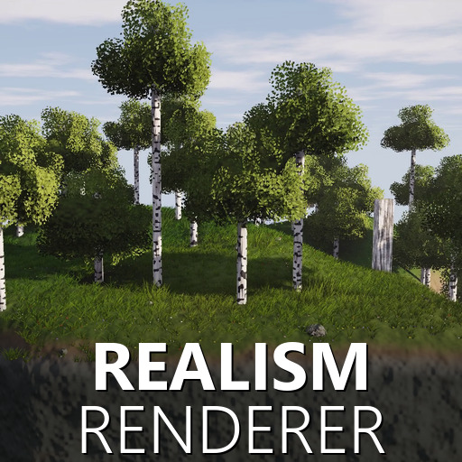
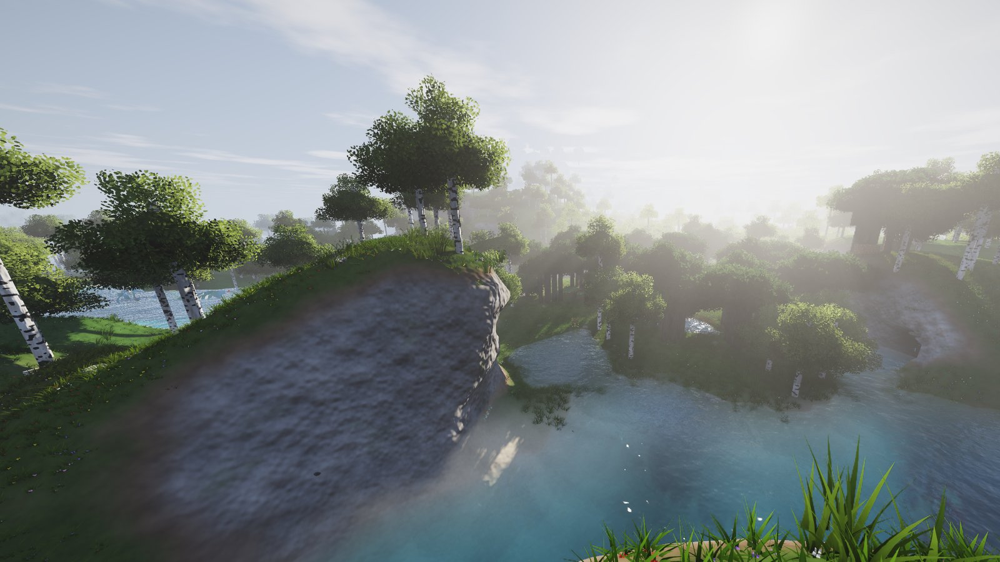
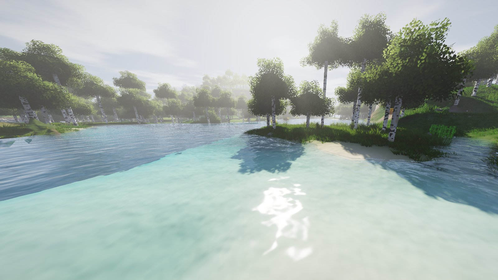
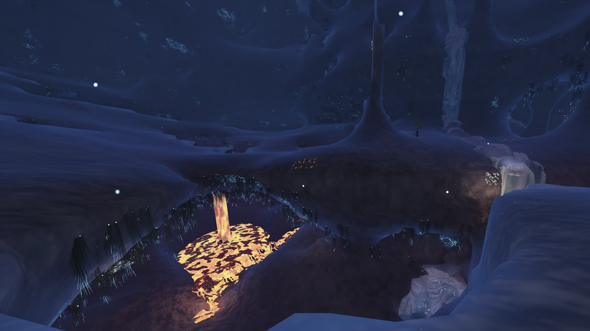
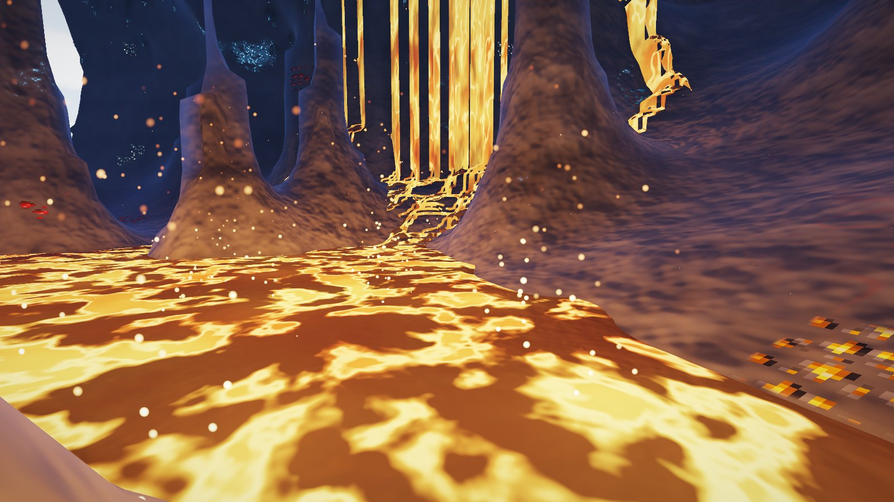
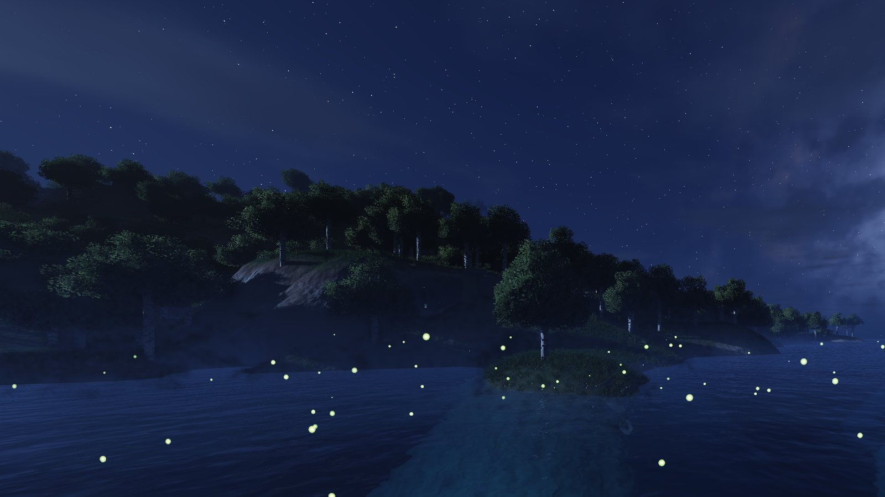

<p align="center"></p>

<h1 align="center">Realism Renderer</h1>

<p align="center"><b>See your Minecraft world the way it would look in real life, live, while you play.</b></p>



Realism Renderer redraws your Minecraft world in real time as a realistic landscape: smooth hills instead of
block staircases, water and lava that flow, caves lit by torchlight and glowing lava, and animals that look like
real animals. You still play Minecraft exactly as normal, with the same world and the same blocks. Minecraft
decides *what* the world is; Realism Renderer decides *how it looks*.

It has two parts:

| Part | Folder | What it does |
|---|---|---|
| **Renderer** (Windows app, C# / .NET 10, OpenGL) | [`Realism/`](Realism) | Draws the world realistically in its own window |
| **Bridge mod** (Fabric, Minecraft 1.21.5) | [`MinecraftMod/`](MinecraftMod) | Streams the world, the player and every block change to the renderer through shared memory |

| | |
|---|---|
|  |  |
|  |  |

## Features

- **Terrain:** smooth hills, cliffs and valleys built from your real blocks; grass, dirt, stone, sand, snow,
  gravel and clay blend naturally; ores show Minecraft's own ore texture set into the rock.
- **Water and lava:** rivers and waterfalls flow the way Minecraft's water does, with reflections, refraction and
  clear shallows; glowing lava rivers with a moving crust and rising embers.
- **Caves:** lit by torches, lanterns and lava, with flickering warm light, glowing amethyst and eye adaptation.
- **Sky:** sunrises and sunsets, stars, shadows, fog, clouds and rain that follow Minecraft's time and weather;
  fireflies at night.
- **Animals:** cows, pigs, sheep, horses, wolves and chickens with natural bodies, moving with Minecraft's own
  animations.
- **Your builds:** placed blocks, torches, rails, chests and glass are drawn with Minecraft's own models and
  textures; nether portals swirl and glow.
- **Gameplay:** play from either window, in first or third person; uses your Minecraft FOV; walk up smooth slopes;
  optional whole-tree felling (toggle in the mod's settings via Mod Menu).

## Requirements

- Windows, and a GPU with OpenGL 3.3 (a dedicated GPU is recommended)
- [.NET 10 SDK](https://dotnet.microsoft.com/download)
- Minecraft Java 1.21.5 with [Fabric Loader](https://fabricmc.net/) 0.16+ and Fabric API; Java 21
- Optional: [ffmpeg](https://ffmpeg.org/download.html) (`ffmpeg.exe` in `Realism\tools\`) for recording videos and
  making comparison videos

## Getting started

```
git clone https://github.com/murmoh/realism-renderer.git
cd realism-renderer
dotnet run --project Realism -c Release -- --live "My World"
```

This builds both parts, starts Minecraft 1.21.5 with the bridge mod straight into that world (leave the name out
for the title screen), and opens the renderer window, which follows the game.

- **Play from the renderer window:** it captures the mouse and drives your player (WASD, mouse, clicks, hotbar).
  **Esc** releases the mouse; **F6** toggles a free camera; **F7** toggles realistic animals; **F2** screenshot.
- **Or play in the Minecraft window:** the renderer follows along, showing the same moment realistically. That is
  how to record side-by-side comparisons.
- **Your own launcher:** build the mod with `MinecraftMod\gradlew.bat build`, put
  `MinecraftMod\build\libs\*.jar` and Fabric API in your `mods` folder, start Minecraft, then run the renderer with
  `--live --no-launch`.

More options (offline viewer for saves, cinematic and gameplay films, diagnostics) are in
[`Realism/README.md`](Realism/README.md).

## Comparison videos

Record both windows side by side (for example in OBS with a 2560x720 canvas), then drag the recording onto
`MakeComparison.bat`. It makes a video with Minecraft on the left of a slowly gliding divider and Realism Renderer
on the right.

## How it works

The mod writes the world into a memory-mapped file (`%LOCALAPPDATA%\PassThroughRealism\bridge.bin`): the camera
every frame, plus a ring buffer of chunks, block changes, entity poses, block models and the texture atlas. The
renderer turns the blocks into smooth surfaces (Surface Nets over a blurred density field), meshes chunks on
background threads, and draws them with physically based lighting, shadows, water, volumetrics and bloom. The
renderer also sends the smooth ground back to the mod, so collision matches the slopes you see.

## License

[MIT](LICENSE). Not an official Minecraft product; not approved by or associated with Mojang or Microsoft.
